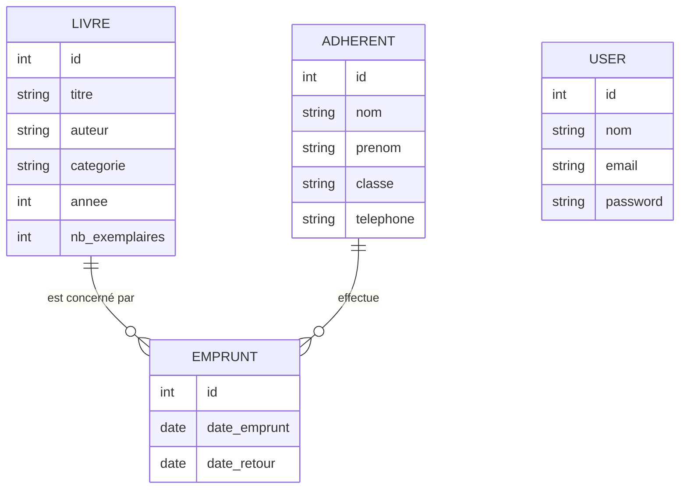

# J1 - MCD / MLD et maquettes

## MCD (modèle conceptuel)



Un livre peut être emprunté plusieurs fois, un adhérent peut effectuer plusieurs emprunts,
un emprunt concerne un seul livre et un seul adhérent. `USER` (bibliothécaire) est indépendant.

## MLD (modèle logique)

- **users** (<u>id</u>, nom, email *unique*, password)
- **livres** (<u>id</u>, titre, auteur, categorie, annee, nb_exemplaires)
- **adherents** (<u>id</u>, nom, prenom, classe, telephone)
- **emprunts** (<u>id</u>, #livre_id, #adherent_id, date_emprunt, date_retour *NULL tant que non rendu*)

Règle métier : exemplaires disponibles = `nb_exemplaires` - nombre d'emprunts du livre dont `date_retour` est NULL.

## Maquettes rapides

**Connexion** : carte centrée avec Email, Mot de passe, bouton « Se connecter ».

**Accueil** : bandeau de présentation + 2 compteurs (livres, adhérents) + boutons d'accès.

**Liste (livres / adhérents)** :
```
[ Titre de la page ]                          [ + Ajouter ]
+----+---------+---------+-----------+----------------------+
| #  | Titre   | Auteur  | ...       | [Modifier][Supprimer] |
+----+---------+---------+-----------+----------------------+
```

**Formulaire (ajout / modification)** : champs empilés avec messages d'erreur, boutons « Enregistrer » et « Annuler ».

**Catalogue public (J3)** : barre de recherche titre/auteur + liste avec mention Disponible / Indisponible.
**Emprunts (J3)** : formulaire (livre + adhérent) et liste des emprunts en cours avec bouton « Retour ».
